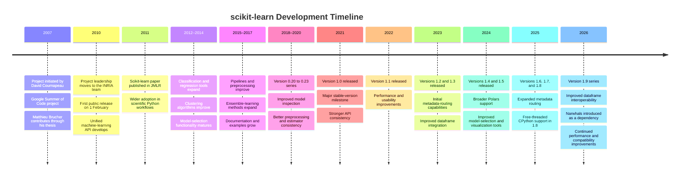

<div align="center">
    <p align="center">
        <a href="https://wikipedia.org/wiki/Scikit-learn">
          
        </a>
    </p>

# **`Awesome`** [Scikit-learn](https://scikit-learn.org/) [](https://awesome.re)
</div>

[]()
[](https://www.reddit.com/r/scikit_learn/new/)

<p align="center">
    <a href="https://github.com/cybersecurity-dev/"></a>
    &nbsp;
    <a href="https://www.youtube.com/@CyberThreatDefense"></a>
    &nbsp;
    <a href="https://cyberthreatdefence.com/my_awesome_lists"></a>
    
</p>



## 📖 Contents
- [Installation Steps](#installation-steps)
- [My Awesome Lists](#my-awesome-lists)
- [Contributing](#contributing)
- [Contributors](#contributors)


## Installation Steps

* Linux
    * **`PIP`** 
      ```bash
        python3 -m venv sklearn-env
        source sklearn-env/bin/activate  # activate
        pip3 install -U scikit-learn
      ```
      In order to check your installation, you can use:
      ```bash
        python3 -m pip show scikit-learn  # show scikit-learn version and location
        python3 -m pip freeze             # show all installed packages in the environment
        python3 -c "import sklearn; sklearn.show_versions()"
      ```
    * **`CONDA`** 
      ```shell
        conda install conda-forge::scikit-learn   
      ```
      Intel optimized version
      ```shell
       conda install scikit-learn-intelex
      ```
* Windows
    * **`PIP`** 
      ```powershell
        python -m venv sklearn-env
        sklearn-env\Scripts\activate  # activate
        pip install -U scikit-learn
      ```
      In order to check your installation, you can use:
      ```powershell
        python -m pip show scikit-learn  # show scikit-learn version and location
        python -m pip freeze             # show all installed packages in the environment
        python -c "import sklearn; sklearn.show_versions()"
      ```
    * **`CONDA`**
      ```powershell
        conda install conda-forge::scikit-learn   
      ```
      Intel optimized version:
      ```powershell
        conda install scikit-learn-intelex
      ```

##

### My Awesome Lists
You can access the my awesome lists [here](https://cyberthreatdefence.com/my_awesome_lists)

### Contributing
[Contributions of any kind welcome, just follow the guidelines](contributing.md)!

### Contributors
[Thanks goes to these contributors](https://github.com/cybersecurity-dev/awesome-scikit-learn/graphs/contributors)!

### License
[](http://creativecommons.org/publicdomain/zero/1.0)

[🔼 Back to top](#awesome-scikit-learn-)
